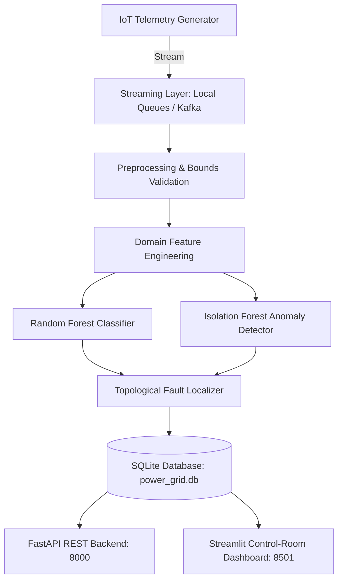

# Power-Grid Fault Big-Data Analytics: A Real-Time Big-Data Monitoring Pipeline Based Solution


---

### Academic Project Details
- **Student Name:** MARUMUDI GEORGE MULLAR
- **Project Guide:** Mr. R. SriRamu
- **Domain:** Big Data Analytics, Data Warehousing & Visualization

---

## 1. Project Introduction
**Power-Grid Fault Big-Data Analytics** is a production-grade, real-time telemetry monitoring and machine learning diagnostics pipeline engineered to protect AC electrical distribution grids. The system ingests high-frequency sensor streams from multiple substations, filters and normalizes incoming telemetry, predicts and classifies operational faults using Random Forest classifiers, detects anomalies via Isolation Forests, and localizes faults down to specific substations, feeders, and sensor nodes with actionable maintenance playbooks.

---

## 2. Problem Statement
Electrical power distribution networks are subject to extreme operational transients, overloads, short-circuits, voltage fluctuations, and thermal stress. Conventional substation monitoring architectures rely on static electromagnetic threshold relays that frequently fail to anticipate complex multi-variable faults, lack automated topological localization, and trigger overwhelming alarm storms during cascade events. An intelligent, automated real-time analytics pipeline is required to ingest high-frequency telemetry, classify faults, and provide immediate remediation advisories.

---

## 3. Project Objectives
- Build a synthetic power-grid telemetry generator simulating 7 operating conditions across 5 regional substations.
- Design a decoupled, real-time streaming pipeline supporting Apache Kafka topics and a high-performance local in-memory alternative for standard Windows laptops.
- Implement an automated preprocessing pipeline for sliding-window deduplication, missing-value imputation, physical bounds validation, and electrical domain feature engineering.
- Train and persist dual machine learning models: a multi-class Random Forest Classifier and an unsupervised Isolation Forest Anomaly Detector.
- Build a topological fault localization engine that identifies the faulted substation, feeder, and sensor node and provides actionable maintenance playbooks.
- Expose complete data operations via a FastAPI REST service and render a supervisory dark-navy control-room dashboard using Streamlit.

---

## 4. Existing System vs. 5. Proposed System

| Feature | Existing Systems | Proposed Solution |
| :--- | :--- | :--- |
| **Data Ingestion** | Periodic polling of RTUs (every 2-4 seconds) | Sub-second real-time streaming (Kafka + Local Queues) |
| **Fault Diagnosis** | Static single-parameter threshold alarms | Multi-variable Machine Learning classification ($>98\%$ accuracy) |
| **Anomaly Detection** | Manual inspection or post-incident analysis | Unsupervised real-time Isolation Forest anomaly scoring |
| **Fault Localization** | Manual line patrols by field crews | Automated hierarchical localization (`Station >> Feeder >> Sensor`) |
| **Operator Interface** | Monolithic, legacy desktop SCADA interfaces | Modern web-based control room with interactive Plotly telemetry charts |
| **Data Warehousing** | Fragmented proprietary data silos | Relational SQLite database with ACID transactions and 1-click CSV exports |

---

## 6. System Architecture



---

## 7. Technologies Used

- **Programming Language:** Python 3.11+ / 3.12 / 3.13
- **Data Engineering:** Pandas, NumPy, StandardScaler
- **Machine Learning:** Scikit-Learn (RandomForestClassifier, IsolationForest), Joblib
- **Streaming Architecture:** In-Memory Multi-Threaded Queue Simulator (Default) & Apache Kafka (Optional)
- **Database:** SQLite 3, SQLAlchemy ORM
- **Backend Services:** FastAPI, Uvicorn, Pydantic v2
- **Dashboard & UI:** Streamlit, Plotly Express/Graph Objects, Custom CSS Control-Room Theme
- **Testing & Packaging:** Pytest, Docker, Docker Compose, Windows Batch Scripts

---

## 8. Module Descriptions

- **Module 1: Sensor Data Generation:** Generates multi-station AC telemetry ($V, I, f, P, Q, \text{pf}, T, \text{Load}\%, \text{Breaker}$).
- **Module 2: Real-Time Streaming:** Decoupled producer/consumer architecture with sliding-window deduplication and Kafka compatibility.
- **Module 3: Preprocessing & Transformation:** Cleans missing values, bounds outliers, and calculates apparent power, impedance, and voltage/frequency deviations.
- **Module 4: Machine Learning Diagnostics:** Multi-class Random Forest (7 classes) and Isolation Forest anomaly detector.
- **Module 5: Fault Localization:** Maps faults across topological nodes and assigns severity (`CRITICAL`, `WARNING`, `NORMAL`) with maintenance playbooks.
- **Module 6: Database Management:** Manages 5 relational tables (`grid_stations`, `sensor_readings`, `fault_predictions`, `anomaly_records`, `system_logs`).
- **Module 7: Real-Time Dashboard:** 8-section Streamlit control room with live streaming charts, KPI tiles, and health gauges.
- **Module 8: Reports & Data Export:** 1-click downloadable CSV reports for sensor data and fault logs.
- **Module 9: REST API Development:** 11+ REST endpoints documented with Swagger UI at `/docs`.

---

## 9. Installation Instructions

### Prerequisites
- Python 3.11, 3.12, or 3.13 installed on Windows, Linux, or macOS.
- Git (optional).

### Step-by-Step Setup
```bash
# Clone or navigate to the project directory
cd Power_Grid_Fault_Big_Data_Analytics

# (Optional) Create virtual environment
python -m venv venv
venv\Scripts\activate      # On Windows
# source venv/bin/activate # On Linux/macOS

# Install dependencies
pip install -r requirements.txt
```

---

## 10. Configuration Instructions
Create or edit `.env` in the project root:
```env
DATABASE_URL=sqlite:///power_grid.db
API_HOST=127.0.0.1
API_PORT=8000
DASHBOARD_PORT=8501
STREAMING_MODE=local
SIMULATION_INTERVAL_SEC=1.0
FAULT_INJECTION_PROBABILITY=0.25
```

---

## 11. Database Structure

1. **`grid_stations`:** Substation metadata, geographical coordinates, capacity (MVA), nominal voltage (kV), operational status.
2. **`sensor_readings`:** Ingested time-series telemetry ($V, I, f, P, Q, \text{pf}, T, \text{load}\%$, breaker status).
3. **`fault_predictions`:** Machine learning diagnosis, confidence score, severity, localization path, maintenance directive.
4. **`anomaly_records`:** Isolation Forest decision scores, anomaly boolean flag, timestamp.
5. **`system_logs`:** Audit log trail recording streaming events, errors, and system status changes.

---

## 12. Machine Learning Workflow

1. **Data Ingestion:** Reads raw telemetry from CSV or real-time streaming buffers.
2. **Preprocessing:** Sanitizes sensor readings and imputes missing fields with column medians.
3. **Feature Engineering:** Computes $S = \sqrt{P^2 + Q^2}$, $Z_{\text{est}} \approx V/I$, $\Delta V$, and $\Delta f$.
4. **Stratified Split:** 80% training / 20% testing split.
5. **Model Training:** Random Forest Classifier ($B=120$ trees, balanced weighting) and Isolation Forest ($12\%$ contamination).
6. **Evaluation:** Computes Confusion Matrix, Precision, Recall, and F1-Score.
7. **Model Serialization:** Saves `.joblib` bundles to `machine_learning/models/`.

---

## 13. How to Generate Sensor Data
```bash
python scripts/generate_data.py
```
Outputs:
- `data/raw/power_grid_telemetry_raw.csv` (7,000 synthetic records)
- `data/sample/power_grid_sample.csv` (500 records)

---

## 14. How to Train the Models
```bash
python scripts/train_models.py
```
Trains Random Forest and Isolation Forest models, computes evaluation matrices, and outputs `.joblib` files to `machine_learning/models/`.

---

## 15. How to Start the Backend
```bash
# Direct Python command
python -m uvicorn backend.api:app --host 127.0.0.1 --port 8000 --reload

# Or Windows batch file
run_api.bat
```
Visit Swagger UI documentation at: `http://127.0.0.1:8000/docs`.

---

## 16. How to Start the Dashboard
```bash
# Direct Streamlit command
streamlit run app/dashboard.py

# Or Windows batch file
run_dashboard.bat
```
Visit the control room at: `http://localhost:8501`.

---

## 17. How to Run the Kafka Pipeline (Optional)
If an Apache Kafka broker is running:
1. Set `STREAMING_MODE=kafka` in `.env`.
2. Start Zookeeper & Kafka Broker on `localhost:9092`.
3. Run the consumer: `python -m streaming.consumer`.

---

## 18. How to Run in Local Simulation Mode (Default)
Local simulation mode requires **no external software or Kafka installation**.
```bash
# Direct CLI Runner
python scripts/run_simulation.py

# Or Windows batch file
run_simulator.bat
```
You can also toggle the streaming pipeline directly inside the Streamlit Dashboard (Section 8: "Stream Controller & Logs").

---

## 19. Complete 1-Click Launch (Windows)

To execute the entire multi-service platform in one go:
```bash
# First-time setup (Initializes DB, trains models, runs tests):
setup.bat

# Launch all 3 services (API, Simulator, Dashboard):
run.bat
```

---

## 20. API Endpoint Documentation

| Method | Endpoint | Description |
| :--- | :--- | :--- |
| `GET` | `/health` | Server health check and diagnostics |
| `GET` | `/sensors` | Historical sensor telemetry readings with pagination |
| `GET` | `/sensors/latest` | Most recent telemetry readings across substations |
| `GET` | `/stations` | Substation topology, GPS coordinates, and status |
| `GET` | `/faults` | Detected faults with severity and localization |
| `GET` | `/faults/latest` | Latest fault incidents |
| `GET` | `/analytics/summary` | Aggregate KPI statistics and health score |
| `GET` | `/analytics/fault-distribution` | Breakdown of faults by category |
| `GET` | `/model/metrics` | Model accuracy, precision, recall, confusion matrix |
| `POST` | `/simulation/start` | Start real-time background telemetry streaming |
| `POST` | `/simulation/stop` | Halt real-time streaming simulator |
| `POST` | `/simulation/inject-fault` | Inject on-demand fault scenario |
| `GET` | `/logs` | Audit logs of system operations |

---

## 21. Automated Testing Suite

Execute the complete pytest verification suite:
```bash
pytest tests/ -v
```
All 7 automated test modules cover:
- Synthetic sensor generation across all 7 operational conditions.
- Preprocessing, bound clamping, and domain feature engineering.
- SQLite database schema initialization and CRUD queries.
- Machine learning inference and fallback behavior.
- Fault localization hierarchy and maintenance playbooks.
- FastAPI REST endpoint status codes and JSON payloads.
- Local streaming queue lifecycle and fault injection.

---

## 22. Limitations & Future Scope

### Limitations
- Telemetry generation is based on synthetic mathematical approximations of AC grid physics; physical hardware deployment requires Phasor Measurement Units (PMUs).
- Local simulation mode uses thread-safe in-memory queues rather than distributed message brokers across physical nodes.

### Future Scope
- Integration with IEEE C37.118 PMU synchrophasor protocol streams.
- Deployment on edge computing microcontrollers (Raspberry Pi / NVIDIA Jetson) at regional feeder cubicles.
- Deep Learning LSTM / Temporal Convolutional Networks for multi-step ahead predictive fault forecasting.
