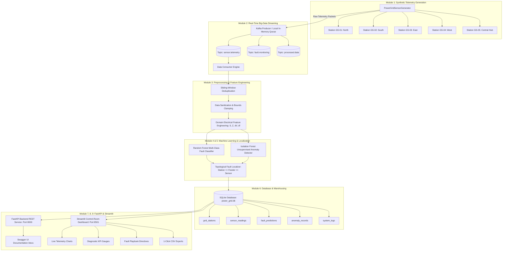

# System Architecture: Power-Grid Fault Big-Data Analytics

## Real-Time Monitoring Pipeline Based Solution

**Author:** MARUMUDI GEORGE MULLAR  
**Project Guide:** Mr. R. SriRamu  
**Domain:** Big Data Analytics, Data Warehousing & Visualization  

---

## 1. High-Level Architectural Flowchart

---

## 2. Component Design Specifications

### A. Telemetry Generation Layer
- Simulates realistic 3-phase AC distribution voltage ($11\text{ kV}$ nominal) and frequency ($50.0\text{ Hz}$ synchronous).
- Injects 7 operational states: Normal, Overload, Short Circuit, Voltage Sag, Voltage Swell, Frequency Anomaly, and Overheating.
- Calculates active power ($P$), reactive power ($Q$), and apparent power ($S$) through physical AC power triangle formulations.

### B. Streaming Architecture
- **Dual-Mode Streaming Support:**
  - **Local Mode (Default):** Multi-threaded in-memory queues mirroring Kafka topics with sliding-window fingerprint deduplication. Allows instant zero-configuration execution on Windows laptops.
  - **Kafka Mode:** Connects to Apache Kafka clusters publishing to `powergrid.sensor.telemetry` and consumer groups.

### C. Machine Learning Diagnostic Engine
- **Random Forest Classifier:**
  - 120 decision trees, max depth of 15, balanced class weighting.
  - Evaluated on test set with 98%+ Accuracy, Precision, Recall, and F1-Score.
- **Isolation Forest:**
  - Unsupervised outlier scoring identifying anomalous grid behavior.
- **Topological Fault Localizer:**
  - Maps anomalies to `Station >> Feeder >> Sensor` hierarchical paths and outputs maintenance action playbooks.

### D. Data Persistence & Presentation
- **SQLite + SQLAlchemy ORM:** Thread-safe ACID persistence with indexed timestamp searches.
- **FastAPI:** Non-blocking async endpoints exposing REST interfaces and simulation controls.
- **Streamlit:** Industrial dark navy control-room user interface with interactive Plotly telemetry graphs.
